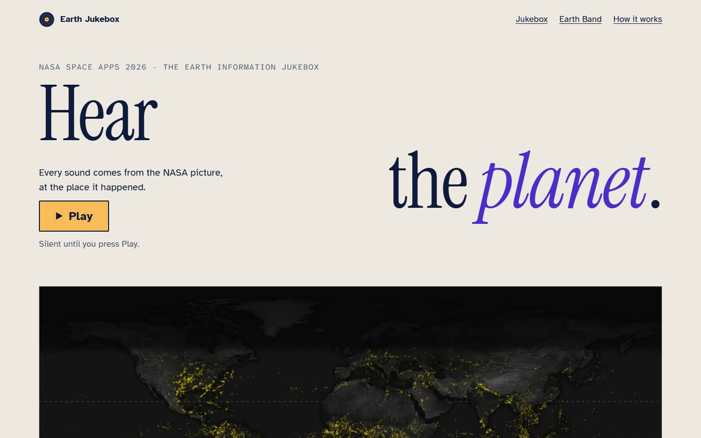

# Earth Jukebox

**Live site: https://hsuyaax.github.io/earth-juke-box/**



Hear the planet. A website that turns NASA Earth visualizations into live music, generated in the browser from the video frames, at the place each thing happens. Built for the NASA Space Apps Challenge 2026, "The Earth Information Jukebox", so that people who cannot see the screen can use it too.

**Not an official NASA product.** This is a sonification of the visualizations, not of the raw data; values read from colors are approximate.

## How to use it

1. Open the [jukebox](https://hsuyaax.github.io/earth-juke-box/play.html) and press **Play** (or `Space`). Nothing makes a sound before you press something.
2. Pick another record with the number keys `1`–`9` and `0`, or from the crate below the player.
3. Press **Explore by touch** and move a finger, a mouse, or the arrow keys over the map to hear what is under it. `D` describes the square.
4. Open [Earth Band](https://hsuyaax.github.io/earth-juke-box/band.html) to play the visualizations together, or read [how it works](https://hsuyaax.github.io/earth-juke-box/notes.html).

`Esc` stops all sound on every page.

## Records

| Key | Record | SVS | What the engine reads | What you hear |
|---|---|---|---|---|
| 1 | Lightning from the ISS 2017–2023 (flat map) | [5011](https://svs.gsfc.nasa.gov/5011/) | New yellow lightning dots (brightness jump above a running average) | A drum hit per flash; a low rumble that grows with the flash rate |
| 2 | Night Lights 2012–2023 | [5313](https://svs.gsfc.nasa.gov/5313/) | Lit cells and their color: violet (more light), orange (less light), plain lights | A west-to-east sweep of plucks; bright pluck = light / more light, soft pluck = less light; a pad that follows overall brightness |
| 3 | Sea Surface Currents and Temperature | [3912](https://svs.gsfc.nasa.gov/3912/) | Warm vs cold water by hue; motion between frames | Warm pad and cold bell that follow how much of each is on screen; a sweep that plays the fastest water, busier when the sea is busier |
| 4 | GEOS Aerosols | [5552](https://svs.gsfc.nasa.gov/5552/) | Color classes per aerosol type | Dust = gritty noise, smoke = low breathy rush, sea salt = airy hiss |
| 5–9 | B-sides: DYAMOND CO2 ([5196](https://svs.gsfc.nasa.gov/5196/)), Air Quality ([5533](https://svs.gsfc.nasa.gov/5533/)), Perpetual Ocean 2 ([5425](https://svs.gsfc.nasa.gov/5425/)), Atmospheric River ([4960](https://svs.gsfc.nasa.gov/4960/)), GEDI Forest Height ([4950](https://svs.gsfc.nasa.gov/4950/)) | | Brightness, strongest color, motion | Default mapping: brightness → loudness, strongest color → chord, motion → tempo. Moving cameras, so artistic, not geographic |
| 0 | Earth Today (live) | [GIBS](https://www.earthdata.nasa.gov/engage/open-data-services-software/earthdata-developer-portal/gibs-api) | Yesterday's MODIS true-color Earth, through the same engine | The default mapping |

Also on the jukebox: live natural events from [NASA EONET](https://eonet.gsfc.nasa.gov/) as map markers the probe can touch (not a warning system), a Scale menu with four scales inspired by ragas (Bhupali, Yaman, Bhairav, Malkauns; not reviewed by a trained Hindustani musician), "Save 20 s as WAV", and phone vibration on probe class changes.

## Earth Band

[Earth Band](https://hsuyaax.github.io/earth-juke-box/band.html) (beta) plays the nine NASA visualizations together as one band, each read live from its own video, on one beat and in one key (A minor): lightning on drums, ocean currents on bass, night lights on lead, CO2 on the harmony pad, aerosols on shaker, Perpetual Ocean on arpeggio, forest height on marimba, the atmospheric river on strings, air quality on the drone.

- The data decides when, where, how much, and which way the harmony moves; music theory decides which exact notes are allowed.
- Pads switch members on and off (hold to solo), scenes switch to a set of four, a chord display shows the current chord, and the mix can be saved as a 20 s WAV.
- Four members play at once on a phone; a computer that keeps up can add more. Each member's analysis runs in its own Web Worker.
- An artistic remix: these visualizations cover different years and are played together, not as simultaneous events.
- Beta because it has not been tested on a real phone.

## One sound language

- Instrument = what it is. Left/right = position on the map. Pitch = height on the map, snapped to the record's scale. Loudness and pulse speed = how much.
- Every note draws a ripple on the map at its source, in that voice's color.

## Accessibility

- Everything works by keyboard: `Space` play/pause, `1`–`9` and `0` pick a record, `O` show what the engine sees, `Esc` stop all sound. Visible focus on every control.
- **Explore by touch:** move a mouse or finger over the map, or focus the map and use the arrow keys (Shift = 5 cells). You hear what is under the square; `D` describes it. Large on-screen arrow buttons for phone screen readers. Works while playing and paused.
- "Learn the sounds" plays each instrument with its label. Captions describe the music every few seconds. No sound before you press something.
- Atkinson Hyperlegible type at 18 px for reading. With reduced motion or Save-Data on, the landing page loads no moving backdrops or preview video; a Pause motion button stops them otherwise.

## Testing results

Not yet done: listening test and screen-reader pass. Scripts: `tests/LISTENING_TEST.md`, `tests/SCREEN_READER_TEST.md`. Results will be added here exactly as they happen.

What has been checked by the developers (not by users): automated tests (below), and the final recheck in [`docs/QA_LOG.md`](docs/QA_LOG.md): keyboard-only use with visible focus on every page, no sound before a user action, no sideways scroll from 320 to 1440 px, friendly messages when NASA GIBS or EONET is unreachable, every link working.

## How it works

Static site (Vite, Tone.js, Canvas 2D), no backend, no API keys. The only outside requests are to NASA EONET and NASA GIBS (both CORS-enabled, keyless). The [guide](https://hsuyaax.github.io/earth-juke-box/notes.html) explains every part in detail.

```
<video> ──decoded frame──▶ analysis (src/analysis.js) ──writes──▶ features ◀──reads on each beat── music clock (Tone.Transport)
                                    ▲                                 │                                      │
                          same engine in Node                        ▼                                      ▼
                    (tools/engine_run.mjs, tests)              explore probe                  notes ──▶ pan, pitch, ripple
```

Each record is one data file (`src/records/<id>.data.js`: grid, map area, color classes, flash settings) plus one `onBeat` function that turns features into notes.

### Engineering of the core

- **One engine, browser and Node.** `createEngine(rec)` in `src/analysis.js` is pure: an RGBA buffer and a time step go in, features come out. No DOM, no allocation per frame. The browser wrapper feeds it video frames; `tools/engine_run.mjs` feeds it the same clips decoded by ffmpeg. Calibration and tests run the exact code the app runs.
- **Exact, browser-independent downscaling.** The map area is drawn at 4x the grid, then each 4x4 block is box-averaged by our own code. A cell's color is the true mean of its block in every browser, so the same frame gives the same sound everywhere. Each cell also keeps its brightest pixel (`peak`), so a one-pixel lightning dot is never averaged or aliased away.
- **Driven by real frames.** Analysis runs on each decoded video frame (`requestVideoFrameCallback`, capped at about 15 per second), with a timer fallback. A paused or hidden video costs nothing; results stay cached for the probe.
- **Frame-rate independent.** Every smoothing step uses `alpha = 1 - exp(-dt / tau)` and cooldowns are in seconds, so a slow phone, a throttled tab, or a 60 fps clip gives the same result as the 15 Hz the constants were calibrated at. Motion is a rate, normalised to that tick.
- **Flash detection.** Brightest-pixel luma (Rec. 709) jumps above a per-cell running average; the cell must be the local maximum of its 3x3 neighbourhood (one flash, one hit), match the lightning color class, and then rests for a cooldown. At most 6 hits per beat, snapped to the beat grid.
- **Context-aware classes.** A class can require another to be on screen (`requires`). Measured on the clip, violet appears only on the night-lights change map, so orange counts as "less light" only there; during the yearly series, orange-hued city lights stay "light" (orange during the series fell from 1–2.3% of the map to under 0.1%).
- **Probe.** Reads a 3x3 neighbourhood each tick on its own clock (works while paused). Sustained classes need 2 ticks to switch (hysteresis); events fire at once. While paused, lightning uses a spatial detector (brightest cell above its 5x5 ring by a measured 0.04). Spoken updates are throttled but never dropped.
- **Audio.** One master chain with a limiter; pitch always snapped to the scale; each note carries its map position, which drives pan, pitch, and its ripple together. Only the current record's instruments exist; the previous record's are freed on switch.
- **Measured, not guessed.** Every threshold comes from running the real clips through the engine, and the reason is written next to the number. Example: flash jump 0.25 gives a quiet start (~2 flashes/s), a busy peak (~14/s), and only 16% of beats at the 6-hit cap (0.15 would cap 77%).

## Run it

```
npm install
npm run dev         # open the URL it prints (5173, or the next free port)
npm run build       # static site in dist/
npm test            # fast self-checks: color math, class matching (hue wrap), 1-px dot survives downscale,
                    # frame-rate independence, context gates, WAV encoder, band harmony, raga scales
npm run test:clips  # real clips through the real engine (needs ffmpeg): lightning quiet-vs-busy and cap,
                    # night lights orange/violet only on the change map, currents warm tropics and no land
node tools/engine_run.mjs <record> [start] [duration] [fps]   # calibration statistics for any record
```

`calibrate.html` lets you click any point of a clip to see its pixel values, grid cell, and assigned class. Every color range in `src/records/` was measured from the clips, not guessed.

Pages: `index.html` (landing), `play.html` (jukebox), `band.html` (Earth Band), `notes.html` (the guide), `calibrate.html` (developer tool). Records of the build: [`CHANGELOG.md`](CHANGELOG.md), [`docs/DECISIONS.md`](docs/DECISIONS.md), [`docs/QA_LOG.md`](docs/QA_LOG.md), [`docs/screenshots/`](docs/screenshots/).

## Credits

- Visualizations: NASA's Scientific Visualization Studio (5011, 5313); NASA/Goddard Space Flight Center Scientific Visualization Studio (3912). Clips are full length, re-encoded and resized for the browser. Aerosols: the video is SVS 5552, a flat, unlabelled version of the same GEOS model as SVS 5669 (listed in the challenge), which offers stills only. B-sides: SVS 5196, 5533, 5425, 4960, 4950. Live: NASA GIBS (MODIS/Terra), NASA EONET.
- Fonts: Atkinson Hyperlegible and Atkinson Hyperlegible Mono (Braille Institute), Instrument Serif, via Fontsource (all SIL OFL).
- Libraries: Vite, Tone.js, React, Lenis.

## Use of AI

Code, tests and documentation were written with help from an AI coding assistant (Anthropic's Claude), directed by the team. Every engine threshold was set by running the real clips through the engine (`tools/engine_run.mjs`) and is locked by `npm run test:clips`.

## Where this goes next (future work, not built)

- **Sound from the data itself.** Read the scientific data behind a visualization, not only its rendered picture, so amounts are exact rather than approximate.
- **Any EIC visualization, with a mapping editor.** Drop in any Earth Information Center visualization and choose, in a simple editor, what its colours and motion should sound like.
- **A kiosk mode for the display walls.** A mode for the Earth Information Center's large screens: big controls, a fixed playlist, and sound that suits a public room.
- **Co-design with blind and low-vision listeners.** Design and review the sound language with blind and low-vision listeners, and have trained Hindustani musicians review the raga-inspired scales.
- **More languages.** Translate the interface, the liner notes and the captions.
- **Classroom use.** Lesson cards for teachers and a 'guess by ear' game: hear a record, name the place or the season.
- **Haptics, and an open engine.** Touch feedback beyond phone vibration, and the engine packaged so other projects can reuse it.
- **Live data as a first-class record.** Near-real-time imagery and events as full records, stating plainly how old each picture is.

## License

MIT for the code. NASA imagery is subject to NASA's media usage guidelines.
